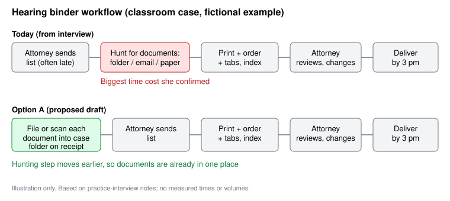

# PRD: Hearing Binder Preparation (Family-Law Firm, classroom case)

> DRAFT for review. Source of all case facts: interview notes with the office manager (practice interview, 7 Nov 2026). This is a classroom case; nothing here is a measured baseline or confirmed requirement for a real implementation, and the stakeholder has not approved this proposal.

## 1. Problem statement

The office manager has to get printed hearing binders to attorneys by 3 pm the day before a hearing. The step that costs her the most time is finding the documents. Some are in the shared case folder, some are in email, and some are only on paper, depending on how they came in.

Her last binder shows how it goes. On Wednesday morning, two documents weren't in the folder when she started. She finished at about 2:45 pm, and she said that's typical.

The attorneys often send their lists the evening before, and they often change them after reviewing the binder. But when we summarized the problem as late lists, she corrected us. The late list isn't what costs her the most time. She said she could handle one if everything were in one place, and the time goes to hunting for documents. We still need to confirm why lists arrive late and why the earlier checklist wasn't used.

## 2. Evidence from the interview

| # | What she described | Type |
|---|---|---|
| E1 | Last binder: hearing Thursday morning, due Wednesday 3 pm. List arrived Tuesday evening. | Stated (recent example) |
| E2 | Two listed items were not in the case folder on Wednesday morning: a signed financial disclosure (paper, on a desk) and an email attachment from opposing counsel (in an inbox). | Stated |
| E3 | She and a legal assistant printed, ordered, and tabbed everything. The attorney reviewed and asked for one document to be swapped. | Stated |
| E4 | Finished at about 2:45 pm. She said it was close and that this is typical. | Stated |
| E5 | Lists often arrive the evening before the deadline. Attorneys often change documents after seeing the binder. | Stated |
| E6 | Where a document lives depends on how it arrived (folder, email, paper). | Stated |
| E7 | After our summary, she corrected us: scattered documents cost more time than late lists. | Stated (correction) |
| E8 | Client files, so she is careful about where things are printed and who handles them. | Stated; the firm's exact rules are unknown |
| E9 | Current tools: shared case folder, email, printer/copier, tab dividers, paper checklist. | Stated |
| E10 | A standard binder checklist was introduced once. Attorneys changed it for their own cases or didn't use it. | Stated; who introduced it, how long it ran, and why it lapsed are unknown |

**Walkthrough (as described):** (1) attorney emails a list; (2) she finds each document in folder, email, or paper; (3) prints and orders them; (4) adds tabs and an index page; (5) attorney reviews and requests changes; (6) she makes changes and delivers by 3 pm.

**Who does vs. who approves:** the office manager and a legal assistant do the work. The attorney reviews and signs off on contents.

**Where it gets stuck:** step 1 (late lists) and step 2 (documents not where expected).

## 3. Options considered

| Option | Idea | For | Against |
|---|---|---|---|
| A. Simple process change (recommended draft) | Every document that arrives for a case, by email or paper, gets saved or scanned into that case's shared folder when it arrives, rather than when a binder is requested. | Targets the cost she confirmed (finding documents). Uses tools they already have. No new software. | Depends on staff and attorneys following it. Paper still needs scanning. Doesn't fix late lists. |
| B. Revive a standard binder checklist | Bring back the paper checklist as a default list of documents. | Could help the attorney's list arrive earlier or more complete. | The earlier checklist was changed or skipped (E10) and we don't know why. Doesn't solve scattered documents. |
| C. New software tool | A system that gathers documents from folder and email for each case. | Could reduce manual hunting. | Cost, confidentiality rules, and fit are all unknown. Heavy for a problem a process change might address. |

**Why A over the others:** she told us the biggest time cost is finding scattered documents, and A addresses that directly with what she already has. B depends on attorney behavior we haven't investigated. C jumps to a solution before we know the firm's confidentiality rules or volumes.

## 4. Proposed approach (Option A)

- **Goal:** by the time an attorney sends a hearing list, the documents for that case are already in one place.
- **What changes:** a simple intake habit. Documents arriving by email or paper are filed or scanned into the case folder on receipt. Details (who, how, naming) are open and should be decided with the office manager.
- **Out of scope for this proposal:** changing when attorneys send lists, building software, changing printing locations or handling rules.

## 5. Assumptions (not established by the interview)

1. Staff and attorneys would file documents on receipt if asked. *Not checked.*
2. Scanning paper documents into the folder is possible within the firm's confidentiality rules. *Not checked; we don't know the rules.*
3. Filing on receipt would save meaningful time at binder time. *She said finding documents costs the most, but we have no measurement.*
4. Late lists are not the main problem. *Her statement; she said she can work with a late list if everything is in one place.*
5. Why lists arrive late is unknown. We shouldn't assume carelessness or deliberate behavior; hearings may be scheduled late.
6. Why the earlier checklist failed is unknown. We shouldn't assume attorneys ignored it.

**Assumption that could change the recommendation:** if documents are scattered mainly because attorneys or opposing counsel send things to personal inboxes the office manager can't see, filing on receipt by her team wouldn't work, and a different approach (for example, a rule about where attorneys forward documents) would be needed.

## 6. Success measures

Baseline and targets are **unknown**. We don't know binders per week, time per binder, or how often the 3 pm deadline is missed. Before any real change, measure those first. Qualitative signal from the interview: the last binder finished at about 2:45 pm with two documents missing initially, and she described this as typical.

## 7. Risks

- Client confidentiality when scanning, printing, or storing documents (rules unknown).
- A new habit adds work for staff who are already squeezed.
- Same fate as the earlier checklist if attorneys don't adopt it.

## 8. Open questions

1. Why do attorneys' lists arrive late? Are hearing dates set late, or is it a workload pattern?
2. Why did attorneys change or skip the earlier checklist, and who introduced it?
3. What are the firm's rules for printing, scanning, and handling client files?
4. How many binders per week, how long each takes, and how often is 3 pm missed?
5. Who receives documents first (attorney, assistant, mail), and could they file on receipt?
6. **Question I wish I'd asked:** *Why do the attorneys' lists arrive so late? I wish I'd asked whether hearing dates are set late or whether it's a workload pattern, because that would show whether earlier filing alone is enough or the list timing also needs to change.*

## 9. Visual

